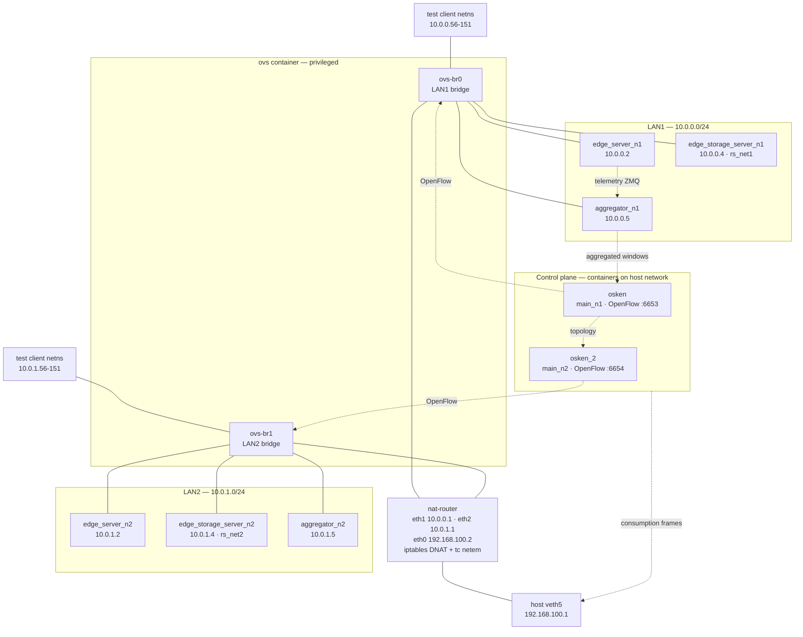

# Architecture

The platform is a set of Docker containers on one Linux host. Two emulated LANs each
hold an edge server, a storage server, a telemetry aggregator and one SDN controller.
A single OVS container bridges both LANs, and a NAT router container is the only path
between them.

Everything is created from the host by `scripts/build_network_setup.sh`; there are no
compose files and no orchestration layer.

## Deployment

## Addressing

`build_network_1.sh` and `build_network_2.sh` give every node a static address and a
static MAC inside its own network namespace; the containers themselves run with
`--network none`.

| Node | LAN1 | LAN2 | MAC suffix |
|---|---|---|---|
| `nat-router` (LAN side) | `10.0.0.1` | `10.0.1.1` | `…:00AA` / `…:00CC` |
| `edge_server_n{1,2}` | `10.0.0.2` | `10.0.1.2` | `…:0002` / `…:0005` |
| `edge_storage_server_n{1,2}` | `10.0.0.4` | `10.0.1.4` | `…:0004` / `…:0006` |
| `aggregator_n{1,2}` | `10.0.0.5` | `10.0.1.5` | `…:0003` / `…:0007` |
| test clients | `10.0.0.56-151` | `10.0.1.56-151` | assigned per client |
| `VIP_SERVER` | `10.0.0.253` | `10.0.1.253` | `aa:bb:cc:dd:ee:01` / `:04` |
| `VIP_DATA` | `10.0.0.254` | `10.0.1.254` | `aa:bb:cc:dd:ee:02` / `:03` |

Clients are plain network namespaces with a veth pair on the bridge — no image, no
container. Their addresses come from the `.56-151` slice of their LAN, and their veth
indices come from ranges (`150-245` for LAN1, `300-395` for LAN2) that are disjoint
from the ones the service-node spawner uses, so a client and a spawned node can never
claim the same interface.

## Control plane

Two os-ken controllers, one per bridge, each in its own container on the host network:

| Container | Module | OpenFlow port | Bridge |
|---|---|---|---|
| `osken` | `sdn_controller.main_n1` | `6653` | `ovs-br0` |
| `osken_2` | `sdn_controller.main_n2` | `6654` | `ovs-br1` |

`build_network_setup.sh` binds each bridge to its controller with
`ovs-vsctl set-controller`. Each controller owns only its own LAN's flows, but the two
share a topology view: each publishes on `TOPOLOGY_PUB_PORT` (`5559` / `5560`) and
subscribes to its peer's endpoint, so a backend behind the other LAN is a visible
candidate for routing. A second pair of ports (`5561` / `5562`) publishes one
consumption frame per telemetry window. That is not a controller-to-controller channel:
the host-side resource collector subscribes to it and records when each window reached
the controller, which is where the consumption timestamp in `resource_stats_debug.csv`
comes from.

## Storage

Each LAN runs its own MongoDB single-member replica set — `edge_storage_server_n1`
hosts `rs_net1` and `n2` hosts `rs_net2`, both on port `27018`, with the database
directory on a named volume.

The host reaches them through the router, which DNATs two WAN-side ports:

| WAN address | Forwarded to |
|---|---|
| `192.168.100.2:27018` | `10.0.0.4:27018` |
| `192.168.100.2:27118` | `10.0.1.4:27018` |

That is why `Makefile` defaults to `mongodb://10.0.0.4:27018/` and
`mongodb://10.0.1.4:27018/` when seeding, and why the host needs routes to both LAN
subnets via `192.168.100.2` — `build_router.sh` programs them.

## Data plane

The two bridges are separate OpenFlow domains. The only inter-LAN link is OVS port `3`
on each bridge (veth3 on `ovs-br0`, veth23 on `ovs-br1`), which leads to the router;
`ROUTER_OVS_PORT=3` encodes that constant. The router applies `tc netem` on its egress
to emulate inter-LAN WAN latency — `scripts/wan.env` sets delay, jitter and loss, and
all-zero values make it a no-op. Internet uplink is deliberately not configured.

## Telemetry

The edge and storage servers push samples to their LAN's aggregator over ZeroMQ
(`AGGREGATOR_PULL_ADDR=tcp://10.0.0.5:5555` on LAN1, `tcp://10.0.1.5:5555` on LAN2).
The aggregator keeps a sliding window, evaluates overload thresholds, and publishes
aggregated windows on `5556` for the controller of that LAN. How the controller
consumes them is described in [telemetry-and-scaling.md](telemetry-and-scaling.md).

## Component map

| Path | Responsibility |
|---|---|
| `docker/edge_server/` | HTTP front end, request lifecycle, feed integrity work, Mongo access |
| `docker/edge_storage_server/` | MongoDB member plus its own telemetry emitter |
| `docker/local_state_server/` | Telemetry aggregator (window, overload detection, publisher) |
| `docker/OVS/` | Open vSwitch container entry point |
| `docker/os-ken/` | Controller runtime image |
| `docker/ubuntu-nat-router/` | Router base image with `iproute2` for `tc` |
| `sdn_controller/` | Controller: VIP routing, topology, telemetry, elasticity, gates |
| `scripts/network/` | Namespace and veth construction, node add/remove, WAN shaping |
| `scripts/testing/` | Workload phases, env overrides, driver, seeding |

Next: [request-path.md](request-path.md) traces a request through this topology.
