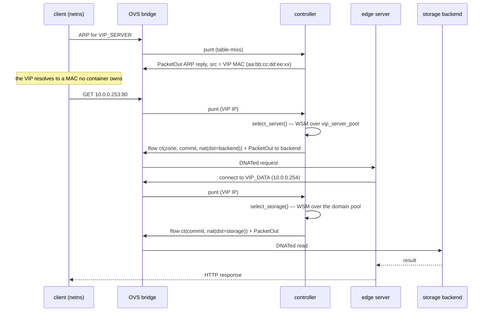

# Request path

A request touches three virtual addresses and two independent load-balancing decisions.
This page follows it end to end.

| VIP | Address (LAN1 / LAN2) | Decides |
|---|---|---|
| `VIP_SERVER` | `10.0.0.253` / `10.0.1.253` | which edge server serves the client |
| `VIP_DATA` (domain `n1`) | `10.0.0.254` | which storage backend `n1` reads use |
| `VIP_DATA` (domain `n2`) | `10.0.1.254` | which storage backend `n2` reads use |

Clients never learn a real backend address. They send to a VIP, and the OVS bridge
rewrites the packet under the controller's instruction.

## End to end



Both decisions happen on the **first packet only**. Once the flow is installed the
bridge matches subsequent packets of that connection and the controller stays out of
the data path.

## Interception

Only two packets per client ever reach the controller:

1. **ARP for a VIP.** The VIP addresses are announced with MACs in the
   `aa:bb:cc:dd:ee:xx` space, which no container owns. The controller answers the ARP
   itself with `_reply_vip_arp()`, so every client believes the VIP sits on the local
   segment. ARP snooping also records the client's MAC/IP binding for later use.
2. **IP packets addressed to a VIP.** Punt rules installed at bridge connect time send
   them up; `handle_vip_packet_in()` dispatches to `_handle_vip_server()` or
   `_handle_vip_data()` depending on the destination address.

`install_vip_arp_punt_rules()` and `install_vip_punt_rules()` cover both VIPs of the
LAN, so the same bridge serves `VIP_SERVER` and its own domain's `VIP_DATA`.

## Backend selection

Selection is a weighted sum model over normalised telemetry, computed per LAN:

```
cost_j = w_cpu·(cpu_j/cpu_max) + w_ram·(ram_j/ram_max)
       + w_req·(req_j/req_max) + w_hops·(hops_j/hops_max)
```

| Dimension | Server weight | Storage weight |
|---|---|---|
| CPU | `W_CPU=0.3` | `W_STORAGE_CPU=0.2` |
| RAM | `W_RAM=0.1` | `W_STORAGE_RAM=0.1` |
| Requests / open connections | `W_REQUESTS=0.2` | `W_STORAGE_CONNECTIONS=0.2` |
| Replication lag | — | `W_STORAGE_LAG=0.2` |
| Hops | `W_HOPS=0.28` | `W_STORAGE_HOPS=0.3` |

A peer-LAN backend is costed at the sum of the local and peer hop averages — roughly
twice a local backend's hop count — which is what keeps a local backend ahead of a
remote one unless the local one is badly loaded. A backend with no telemetry yet is
scored with an unknown-stats default rather than being excluded.

The `vip_server_pool` is the union of this controller's servers and those learned from
its peer, so a LAN1 client can be routed to a LAN2 edge server.

### Selection policies

`BACKEND_SELECTION_POLICY` picks how strictly the lowest cost wins:

| Value | Behaviour |
|---|---|
| `topology_lifecycle` (default) | WSM plus **warm leases**: a client that already used a backend keeps it while the lease is warm, so a burst does not scatter one client's requests across replicas |
| `topology_slowstart` | WSM plus a slow-start penalty on recently spawned backends, so a cold replica is not immediately buried |
| `topology_host` | Plain WSM, no warm lease and no slow-start penalty |

Warm-lease claiming is skipped entirely outside `topology_lifecycle`; the other two
modes rely on the cost function alone.

`_BACKEND_SELECTION_SPREAD_EPS`, when greater than zero, turns strict argmin into a
band: all candidates within `eps` of the pool minimum are distributed across clients by
a deterministic hash, with `_BACKEND_SELECTION_SPREAD_MIN_BAND` keeping at least the
`k` cheapest local units in the band. With `eps = 0` the behaviour is plain argmin with
round-robin on exact ties.

The storage pool builds the same band under `STORAGE_SELECTION_SPREAD_EPS` and
`STORAGE_SELECTION_SPREAD_MIN_BAND`, with two differences: a live warm claim returns
before the band is built, and the pick inside the band is round-robin over the
per-domain counter rather than a hash. Both storage knobs default to off, so storage
selection is plain argmin with round-robin on exact ties unless an override enables it.

## Flow installation

The rule is a conntrack NAT, not a static rewrite:

```
match:  eth_src=client, ipv4_src=client_ip, ipv4_dst=VIP
action: ct(zone=Z, commit, nat(dst=backend_ip)), output:backend_port
```

Each `VIP_DATA` domain has its own conntrack zone (`n1 → 1`, `n2 → 2`), so the two
domains cannot collide and the reply direction can look the connection up in the zone
it was committed to. A reply rule matches on the backend subnet — `n1` backends always
live in `10.0.0.0/24`, `n2` in `10.0.1.0/24` — which is what makes the two reply rules
distinguishable.

Two consequences:

- **An established connection is never re-pinned.** Forward rules are installed on the
  SYN and expire on the domain's idle timeout (`VIP_DATA_IDLE_TIMEOUT`, default 10 s,
  chosen against an observed request-segment p50 of 2–6 s so that queued-but-alive
  connections survive). Re-pinning an already-committed conntrack entry to a different
  backend port would break it, so the timeout — not a new decision — ends the flow.
- **Bulk deletion is cookie-based.** All per-client flows of a domain share one cookie,
  so unregistering a storage backend removes exactly its flows.

`VIP_DATA_PER_CONNECTION_FLOWS=1` extends the match with `tcp_src`, so an edge server
holding a Mongo connection pool fans its connections across storage backends instead of
pinning everything to the backend chosen for the first one.

## Cross-LAN forwarding

When the chosen backend is on the peer LAN, the action cannot simply rewrite the
destination: the packet has to leave through the router. The controller sets the
gateway MAC on the way out and relies on OVS port `ROUTER_OVS_PORT` (`3`) to reach
`nat-router`, which routes between `10.0.0.0/24` and `10.0.1.0/24` and applies the
`tc netem` shaping from `scripts/wan.env`. Internet uplink is not configured, so the
router is only ever an inter-LAN hop.

Next: [telemetry-and-scaling.md](telemetry-and-scaling.md) follows what the platform
observes and decides while it serves that traffic.
