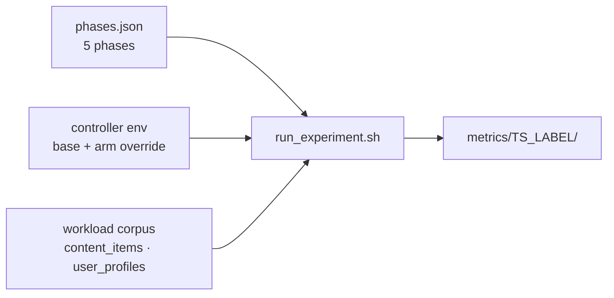

# Running experiments

A run is a sequence of timed workload phases driven from the host, with the platform's
telemetry, decisions and scaling events recorded alongside.

## Anatomy of a run



`run_experiment.sh` snapshots the two inputs it was given — the phase profile and the
merged controller environment — into the run folder before the first request. That is
what makes a run self-describing after the fact.

## Phases

`scripts/testing/phases.json` is the canonical profile. Each phase sets a duration, a
per-client rate, the fraction of clients active, how much traffic crosses LANs, and the
request mix.

| Phase | Duration | Rate/client | Clients | Cross-region | Mix |
|---|---|---|---|---|---|
| `baseline` | 60 s | 1.0 | 10 % | 0 | mixed |
| `compute_plateau` | 600 s | 2.0 | 100 % | 0 | service pressure |
| `recovery_gap` | 120 s | 0.5 | 5 % | 0 | mixed |
| `demand_drop` | 420 s | 1.0 | 10 % | 0 | mixed |
| `idle_tail` | 420 s | 0.05 | 5 % | 0 | mixed |

The shape is deliberate: a short baseline, a long sustained plateau that forces
scale-up, a deliberately thin phase that lets the platform recover, then a drop and a
tail long enough for scale-down guards to expire. `cross_region_ratio` sets the
fraction of `content_lookup` requests a client sends to the peer LAN's content
region; it is `0` in every shipped profile, so every shipped workload is LAN-local.

`phases.json` is the canonical phase profile and the one the readiness-admission
campaign ran with. The profiles the other campaigns ran are in
`scripts/testing/phases_campaigns/`, one file per campaign, each a verbatim copy of the
`phases_snapshot.json` its runs recorded. A new workload edits `phases.json` in place
and passes it through `PHASES_CONFIG`; it is never copied to a variant name.

## Controller configuration

Two files always participate:

```
base      scripts/osken-controller.env
override  scripts/testing/controller_env_overrides/current_state_integrated.env
```

`build_network_setup.sh` merges them and validates the result, then passes the merged
file to both controllers. A campaign arm adds a third file through
`OSKEN_ENV_OVERRIDE_FILE`; **only one override is honoured**, so an arm that needs two
contributions merges them itself and passes the result.

Provenance is printed at build time and recorded in `controller_env_snapshot.env`, so a
run always says which base, which override, and which arm produced it.

## Launching

A run is started through the generic driver, which fixes nothing of its own: the phase
profile and the arm are the two inputs that select a treatment.

```bash
# RQ1 — the load rise, telemetry arm "delayed push"
PHASES_CONFIG=testing/phases_campaigns/rq1_load_rise.json \
OSKEN_ENV_OVERRIDE_FILE=testing/controller_env_overrides/rq1_delayed.env \
  make setup_network create_clients setup_test_data run_experiment \
       RUN_LABEL=rq1-delayed

# RQ2 — the data-access press, storage-first action
PHASES_CONFIG=testing/phases_campaigns/rq2_data_access_press.json \
OSKEN_ENV_OVERRIDE_FILE=testing/controller_env_overrides/rq2v4_mode_stor.env \
  make setup_network create_clients setup_test_data run_experiment \
       RUN_LABEL=rq2-storage

# RQ3 — the admission plateau, discovery mode
PHASES_CONFIG=testing/phases.json \
OSKEN_ENV_OVERRIDE_FILE=testing/controller_env_overrides/rq3_direct.env \
  make setup_network create_clients setup_test_data run_experiment \
       RUN_LABEL=rq3-admission
```

A treatment is therefore selected by two inputs: the phase profile in force and the arm
file named in `OSKEN_ENV_OVERRIDE_FILE`. The profile a campaign ran is shipped in
`testing/phases_campaigns/` (mapped campaign by campaign in its README), and every run
folder also carries the profile it executed as `phases_snapshot.json`.

`make run_experiment` drives the load with `TRAFFIC_DRIVER_MODE=open_loop`, the mode
every campaign ran: one long-lived worker per client namespace holding an in-flight
window of 1024 requests and draining for 30 s at each phase boundary. The alternative,
`TRAFFIC_DRIVER_MODE=sync`, issues one `curl` per request and is kept only as a
regression check.

## What a run produces

Everything lands in `scripts/testing/metrics/<timestamp>_<label>/`. Passing
`run_experiment.sh --batch-dir DIR` nests that folder one level deeper, under
`metrics/DIR/`, so consecutive arms of one campaign can be collected together.

| File | Contents |
|---|---|
| `client_requests.csv` | One row per request: latency, endpoint, phase, client, status |
| `resource_stats.csv` | Per-LAN window summaries: request count, mean CPU, processing and database latencies |
| `resource_stats_debug.csv` | Per-container medians per window, plus the consumption timestamp |
| `per_node_stats.csv` | Per-node CPU and memory samples behind those summaries |
| `controller_stats.csv` | Controller container CPU and memory, sampled every 5 s |
| `container_events.csv` | Docker lifecycle events |
| `elasticity_events.csv` | Scale-up, scale-down and admission events |
| `run_status.json` | Outcome, timing and per-stage status |

The controller side is recorded per LAN, because each LAN has its own controller:

| File | Contents |
|---|---|
| `decision_log_lan{1,2}.csv` | Raw controller decisions per LAN |
| `telemetry_delivery_log_lan{1,2}.csv` | Summary sequence, arrival and gaps as seen by the consumer |
| `window_log_lan{1,2}.jsonl` | Aggregator windows before any transport effect |
| `ack_log_lan{1,2}.jsonl` | The aggregator's acknowledgement of each published window |
| `admission_log_lan{1,2}.csv` | Readiness admissions and abandonments |

These files carry the per-question evidence. The window log and the delivery log are
complementary, not redundant: the first is what the platform produced, the second is
what the controller received, so the difference between them is the transport effect
under study. The admission log is the readiness-admission record.

The configuration in force is dumped alongside, so a run says what produced it:

| File | Contents |
|---|---|
| `phases_snapshot.json` | The phase profile in force |
| `controller_env_snapshot.env` | The merged controller environment in force |
| `aggregator_env_snapshot.env` | The aggregator environment in force |

Transient files also appear and are not analysis inputs: `controller_lan{1,2}.log` (the
raw `docker logs` capture), `service_logs/` (per-container service logs) and
`current_phase.txt`.

`metrics/active_run.json` points at the run in progress, which is how a watcher finds
the live folder without guessing the timestamp.

## Analysis

The run folder is self-describing: every latency in `client_requests.csv` carries its
phase and client, every container sample in `resource_stats.csv` carries its timestamp,
and `controller_env_snapshot.env` and `phases_snapshot.json` record the configuration
that produced them. The outcome definitions, the contrasts and the statistical tests
applied to these files are given in the thesis; the analysis scripts themselves are not
part of this repository.

## Tearing down

```bash
make teardown_clients    # removes client namespaces then runs cleanup.sh -v
```

`cleanup.sh` removes containers, bridges, veth pairs and the host routes the router
needs, so a failed run does not leave the next one starting from a dirty host.

`make cleanup_metrics` deletes every run folder under `testing/metrics/` and nothing
else, which is the quickest way to reclaim disk between campaigns.

Next: [architecture.md](architecture.md) describes the topology the run executes on.
