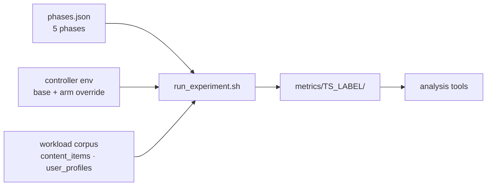

# Running experiments

A run is a sequence of timed workload phases driven from the host, with the platform's
telemetry, decisions and scaling events recorded alongside.

## Anatomy of a run



`run_experiment.sh` snapshots the three inputs it was given — the phase profile, the
merged controller environment, and the fault plan if any — into the run folder before
the first request. That is what makes a run self-describing after the fact.

## Phases

`scripts/testing/phases.json` is the canonical profile. Each phase sets a duration, a
per-client rate, the fraction of clients active, how much traffic crosses LANs, and the
request mix.

| Phase | Duration | Rate/client | Clients | Cross-region | Mix |
|---|---|---|---|---|---|
| `baseline` | 60 s | 1.0 | 10 % | 0 | mixed |
| `compute_plateau` | 600 s | 2.0 | 100 % | 0 | service pressure |
| `recovery_gap` | 120 s | 0.5 | 5 % | 0 | mixed |
| `demand_drop` | 420 s | 1.0 | 10 % | 0 | mixed |
| `idle_tail` | 420 s | 0.05 | 5 % | 0 | mixed |

The shape is deliberate: a short baseline, a long sustained plateau that forces
scale-up, a deliberately thin phase that lets the platform recover, then a drop and a
tail long enough for scale-down guards to expire. `cross_region_ratio` is what drives
Tier 1 promotion (see [storage-and-selective-sync.md](storage-and-selective-sync.md));
it is `0` in the canonical profile and raised by the arm that needs it.

Alternative profiles live in `scripts/testing/phases_override/` and are selected per
launcher via `PHASES_CONFIG`. The canonical file is edited in place when a campaign
needs a different workload — it is never copied to a variant name.

## Controller configuration

Two files always participate:

```
base      scripts/osken-controller.env
override  scripts/testing/controller_env_overrides/current_state_integrated.env
```

`build_network_setup.sh` merges them and validates the result, then passes the merged
file to both controllers. A campaign arm adds a third file through
`OSKEN_ENV_OVERRIDE_FILE`; **only one override is honoured**, so a launcher that needs
two contributions merges them itself and passes the result.

Provenance is printed at build time and recorded in `controller_env_snapshot.env`, so a
run always says which base, which override, and which arm produced it.

## Launching

Each launcher fixes the constants of its campaign and forwards everything else:

```bash
# RQ1 — stress plateau phases, telemetry arm from controller_env_overrides/
bash testing/rq1_launch_run.sh rq1_delayed my-label 2001

# RQ3 — saturation phases, direct vs discovery admission
bash testing/rq3sat_launch_run.sh rq3sat_direct my-label 3001

# RQ2 — policy arm, modes come from rq2v4_mode_*.env
bash testing/rq2v5_launch_run.sh both my-label 2001
```

The launchers all end in the same `make` invocation
(`setup_network create_clients setup_test_data run_experiment`), so a run started this
way is identical in structure to one started by hand.

## What a run produces

Everything lands in `scripts/testing/metrics/<timestamp>_<label>/`:

| File | Contents |
|---|---|
| `client_requests.csv` | One row per request: latency, endpoint, phase, client, status |
| `resource_stats.csv` | Per-container CPU, memory, network samples |
| `controller_stats.csv` | Per-node stats as the controller saw them |
| `policy_state.csv` | Per-window policy state as the controller recorded it |
| `elasticity_events.csv` | Scale-up, scale-down, admission and release events |
| `container_events.csv` | Docker lifecycle events |
| `decision_log_lan{1,2}.csv` | Raw controller decisions per LAN |
| `per_node_stats.csv` | Aggregated per-node statistics |
| `phases_snapshot.json` | The phase profile in force |
| `controller_env_snapshot.env` | The merged controller environment in force |
| `run_status.json` | Outcome, timing and per-stage status |

`metrics/active_run.json` points at the run in progress, which is how a watcher finds
the live folder without guessing the timestamp.

## Analysis

The analysers are offline and take a run directory, so they can be run against a copied
folder:

```bash
python3 testing/analysis/cli_overview.py       --run-dir metrics/20260101_120000_label
python3 testing/analysis/cli_phase_summary.py  --run-dir metrics/20260101_120000_label
python3 testing/analysis/cli_scale_down.py     --run-dir metrics/20260101_120000_label
python3 tools/metrics_stats.py                 metrics/20260101_120000_label
```

Per-RQ analysers live under `testing/analysis/rq1/`, `rq2/` and `rq3/`; the RQ1 and RQ2
scripts carry a development-machine path as their default input directory and need that
constant pointed at your run folder first.

## Tearing down

```bash
make teardown_clients    # removes client namespaces then runs cleanup.sh -v
```

`cleanup.sh` removes containers, bridges, veth pairs and the host routes the router
needs, so a failed run does not leave the next one starting from a dirty host.
