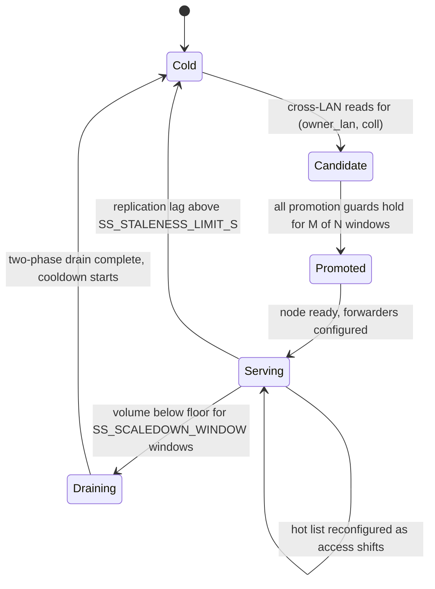

# Storage and selective sync

Storage has two independent adaptation axes:

- **Full replicas.** A domain can grow extra `edge_storage_server` members, each a
  complete copy of the domain's data. This is the `MAX_DYNAMIC_STORAGE` axis
  described in [telemetry-and-scaling.md](telemetry-and-scaling.md).
- **Selective sync (Tier 1).** A LAN can hold a *partial*, read-only cache of another
  domain's hot collections, so repeated cross-LAN reads stop paying the WAN hop.

The second axis is the one with the interesting decision logic, so it gets this page.

## Two tiers

| Tier | Container | Holds | Serves |
|---|---|---|---|
| Tier 0 | `edge_storage_server_n{1,2}` | The domain's complete data, as a MongoDB member | All reads and writes for its domain |
| Tier 1 | `edge_selective_storage` | A hot subset of one owner domain's collections, `mongod` **standalone** (no replica set) | Local reads; writes are forwarded to the owner |

A Tier 1 node belongs to a *consumer* LAN and replicates from a specific
*owner* LAN. That pairing — `(owner_lan, collection)` — is the unit the controller
decides about, not the node.

## Lifecycle

## What triggers promotion

The controller runs a `PromotionCoordinator` on every telemetry window. It merges the
per-edge access slices reported by every edge server in the consumer LAN into one view
per `(owner_lan, collection)`, then requires **all** of the following:

| Guard | Default | Why |
|---|---|---|
| Cross-region read share ≥ `SS_PROMOTION_CROSS_REGION_THRESHOLD` | `0.4` | The collection must genuinely be read from the far side |
| Reads this window ≥ `SS_MIN_READS_PER_WINDOW` | `14` | Filters trivial query bursts; tuned to the 15–40 range the cross-region phase produces |
| Write ratio ≤ `SS_WRITE_RATIO_MAX` | `0.30` | Tier 1 replicates reads only — a write-heavy collection pays full cost for little benefit |
| QoE breach in at least `M` of the last `N` windows | `2` of `5` | `t_db_p95_ms` for the owner LAN above the edge's `TAU_DADOS_MS` |

The last guard mirrors the debounce on the full-replica path (2-of-5 for storage,
3-of-5 for compute), so a single noisy window cannot spawn a node.

### What actually gets copied

Not the collection — the **hot document list**. Each edge server reports the documents
it reads; the coordinator merges the slices and keeps the top
`SS_HOT_DOC_LIMIT` (default `50`) per `(owner_lan, collection)`. A Tier 1 node is
therefore sized by access pattern rather than by data volume, and `SS_MAX_TTL_S`
(default `0`, disabled) can put a belt-and-suspenders expiry on cached documents.

## Serving

The container runs a supervisor plus a forwarder per collection:

- **Reads** are answered from the local standalone `mongod`.
- **Writes** are forwarded to the owner domain, so the owner stays authoritative.
- **Replication** follows the owner's change stream. The supervisor emits `lag_s` per
  collection as `now − change.clusterTime` when a change is applied locally.

The lag signal is the safety valve: exceeding `SS_STALENESS_LIMIT_S` (default `10 s`) on
*any* collection tears the whole container down. A Tier 1 node shares one `mongod` and
one remote connection, so one stale collection implicates all of them — keeping part of
a stale node alive would silently serve inconsistent reads.

## Scale-down

A collection leaves the node when its cross-region hit rate falls below
`SS_SCALEDOWN_THRESHOLD` (default `5` per window) for `SS_SCALEDOWN_WINDOW` consecutive
windows (default `8`). The node is then reshaped rather than destroyed, via
`POST /forwarder_config` on its admin endpoint.

When the whole node goes, it goes in two phases — `POST /drain` first, mirroring the
compute path, then teardown. After teardown the direction cannot be promoted again for
`SS_COOLDOWN_S` (default `90 s`), which stops thrash when the cross-region predicate is
still true on the very next window.

## Enabling it

Tier 1 is off by default:

| File | `SS_ENABLED` |
|---|---|
| `scripts/osken-controller.env` | `0` |
| `scripts/testing/controller_env_overrides/current_state_integrated.env` | `1` |

The base file is a no-op baseline for reproducibility; every campaign turns the
subsystem on through the override. With `SS_ENABLED=0` the coordinator never runs, no
`edge_selective_storage` container is ever spawned, and reads stay on Tier 0.

## Full replicas, for contrast

Storage scale-up adds a complete `edge_storage_server` member to the domain's replica
set. It is capped at `MAX_DYNAMIC_STORAGE` (`3` per LAN in the canonical override, `5`
in the base file), grows with a score built from storage CPU and `t_db` latency, and is
retired only after `SCALE_DOWN_STORAGE_REQUIRED` quiet windows followed by
`SCALEDOWN_STORAGE_COOLDOWN_S`. Unlike Tier 1, it copies everything and can accept
writes.
