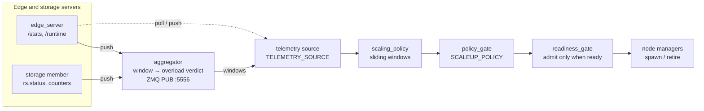
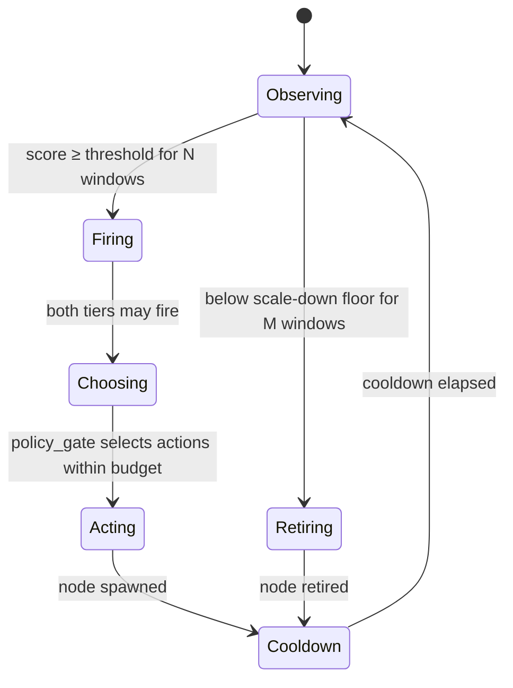

# Telemetry and scaling

Scaling is a two-stage loop: collect per-window telemetry, then decide from it. The two
stages are independent modules and can be replaced separately.



## Collection

`TELEMETRY_SOURCE` selects how the controller observes the platform. All five sources
implement the same `TelemetryEventSource` interface and produce the same
`TelemetrySummary`, so the decision layer cannot tell them apart.

| `TELEMETRY_SOURCE` | Source | Behaviour |
|---|---|---|
| `zmq` (default) | `ZmqTelemetrySource` | Subscribes to the aggregator's published windows; the aggregator has already folded the samples and applied the overload thresholds |
| `poll` | `PollingTelemetrySource` | Controller fetches each node's stats endpoint every `POLL_INTERVAL_S` |
| `event_preserving` | `EventPreservingTelemetrySource` | Push with sequence validation; every window either arrives or is logged as a gap, never silently dropped |
| `delayed_event_preserving` | `DelayedEventPreservingTelemetrySource` | Same as above, with a configurable delivery delay — models a lagging control plane |
| `sampled_push` | `SampledPushTelemetrySource` | Push that samples rather than preserving every window |

Every source except `zmq` writes a `DeliveryLog`, tagged with the delivery mode of the
arm that produced it. It distinguishes a real gap (`gap_recovery`: the window aged out
or was never delivered) from a window that simply had no traffic, which is what makes
"the controller never saw this window" and "there was nothing to see" separable after
the fact.

### The aggregator

Each LAN has one `aggregator_n{1,2}` (`docker/local_state_server/`) that pulls samples
from its own LAN's nodes and evaluates a window against the overload thresholds:

| Knob | Meaning |
|---|---|
| `WINDOW_S` | Window length (default 10 s) |
| `OVERLOAD_CPU_PCT` | CPU percentage that counts as overloaded |
| `OVERLOAD_PEAK_LATENCY_MS` | Peak latency that counts as overloaded |
| `OVERLOAD_ERROR_RATE` | Error rate that counts as overloaded |
| `OVERLOAD_MIN_REQUESTS` | Minimum request count before the verdict is meaningful |

It publishes the folded window on `5556`. Both `WINDOW_LOG_PATH` and `ACK_LOG_PATH`
are written as JSONL, so the raw window series survives a run.

## Decision

`scaling_policy.py` owns sliding-window deques and cooldown timestamps, and turns
`DomainSummary` metrics into a `ScaleUpVerdict` per tier. It performs no I/O and never
calls the node managers — the mediator in `main_n*.py` does.

A tier fires when its **score** crosses a threshold that adapts to recent history:

```
score_storage = SCALEUP_W_STORAGE_CPU·norm(cpu) + SCALEUP_W_T_DB·norm(t_db)
score_compute = SCALEUP_W_CPU·norm(cpu)         + SCALEUP_W_T_PROC·norm(t_proc)
```

Each normalised term is `(value − floor) / span`, with `SCALEUP_*_FLOOR` and
`SCALEUP_*_SPAN` setting the useful range. The threshold starts at
`SCALEUP_*_BASE_THRESHOLD`, rises by `SCALEUP_*_THRESHOLD_INCREMENT` each time a
scale-up is acted on (capped by `SCALEUP_*_MAX_THRESHOLD`), and the verdict must
persist for `SCALEUP_REQUIRED` / `SCALEUP_STORAGE_REQUIRED` consecutive windows.



### Choosing what to do

`policy_gate.py` is a pure function from two verdicts to a set of actions. Its
`SCALEUP_POLICY` selects which of the fired tiers become actions:

| Mode | Behaviour |
|---|---|
| `dual` (default, and what every shipped arm runs) | Every fired tier is selected, no budget — the pre-RQ2 behaviour |
| `fixed_compute_first` | Compute only, never storage |
| `fixed_storage_first` | Storage only, never compute |
| `bottleneck_aware` | Classify the bottleneck from tier telemetry and select the matching tier |

Outside `dual`, the gate also applies a per-tier action budget, so a fired tier does not
necessarily produce an unbounded number of spawns. `dual` disables the budget, which
leaves the per-tier caps as the only bound on how far a tier can grow.

### Admitting a backend

A spawned compute node is not usable immediately. `readiness_gate.py` gates admission
to the `VIP_SERVER` pool on a verified readiness signal, under two modes:

| `READINESS_PROPAGATION` | Admission |
|---|---|
| `direct` | Admit on the edge's `app_ready` control event; `/ready` is used only for the post-admission identity check and the `READINESS_EVENT_FALLBACK_S` safety net |
| `discovery` | Admit when a probe pass observes a `200`, on the `DISCOVERY_POLL_INTERVAL_S` cadence |

A node that never becomes ready is abandoned rather than admitted, so the routing pool
only ever contains backends that can serve.

### Retiring a backend

Scale-down is deliberately slower than scale-up and has two guards:

- **Cooldown after scale-up** (`SCALEDOWN_COMPUTE_COOLDOWN_S`, `SCALEDOWN_STORAGE_COOLDOWN_S`) prevents a fresh node from being retired before it has been used.
- **Required consecutive windows** (`SCALE_DOWN_COMPUTE_REQUIRED`, `SCALE_DOWN_STORAGE_REQUIRED`) filter out a single quiet window.

## Caps and tunables

The base `scripts/osken-controller.env` carries the defaults; the canonical override
`scripts/testing/controller_env_overrides/current_state_integrated.env` retunes them for
the campaigns. The values that most affect behaviour:

| Knob | Base `osken-controller.env` | Canonical override |
|---|---|---|
| `MAX_DYNAMIC_COMPUTE` / `MAX_DYNAMIC_STORAGE` | **0 / 5** per LAN | **3 / 3** per LAN |
| `SCALEUP_COMPUTE_COOLDOWN_S` | 45 | — |
| `SCALEUP_STORAGE_COOLDOWN_S` | — | 120 |
| `SCALEDOWN_COMPUTE_COOLDOWN_S` | 180 | 180 |
| `SCALE_DOWN_COMPUTE_REQUIRED` | — | 9 |
| `SCALEDOWN_STORAGE_COOLDOWN_S` | 120 | **30** |
| `SCALE_DOWN_STORAGE_REQUIRED` | 9 | **3** |
| `SCALEUP_POLICY` | code default `dual` | `dual` — no arm changes it |

The base file ships compute scaling disabled (`MAX_DYNAMIC_COMPUTE=0`); every campaign
raises it through the override. The caps are per LAN and count only dynamic nodes — the
static `.2` / `.4` / `.5` nodes never count against them.

Next: [running-experiments.md](running-experiments.md) shows how these are set for a run.
